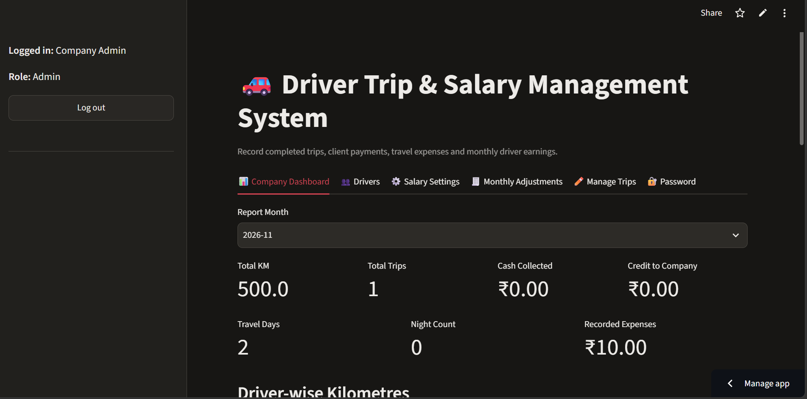

# 🚗 Driver Trip & Salary Tracker

A cloud-based, mobile-friendly web application developed using **Python and Streamlit** to manage company drivers' daily trips, travel expenses, payments and monthly salary calculations.

The application uses **Supabase** as its cloud database to store and manage driver trip records, allowing administrators and drivers to access shared data through their accounts.

##  Project Overview

Managing daily driver trips, expenses and salary calculations manually can be time-consuming.

The Driver Trip & Salary Tracker simplifies this process by providing a centralized platform to record trips, monitor expenses, track payments and calculate monthly driver earnings.

The application is designed to work across mobile phones, tablets and desktop devices, making it convenient for drivers to record their trips from anywhere.

##  Key Features

### 1. Driver Management
- Create and manage driver accounts.
- Individual login credentials for drivers.
- Separate access for administrators and drivers.
- Manage driver information and records.

### 2. Daily Trip Tracking
- Record daily completed trips.
- Track travel dates and destinations.
- Record kilometres travelled.
- Edit or delete incorrect trip entries.
- Maintain individual driver trip histories.

### 3. Expense Management
- Track toll charges.
- Record parking expenses.
- Maintain additional trip-related expenses.
- Monitor daily travel expenses.

### 4. Payment Tracking
- Differentiate between Cash and Credit payments.
- Maintain payment records.
- Track client payment categories.

### 5. Salary Management
- Calculate earnings based on kilometres travelled.
- Record night bata and additional allowances.
- Manage monthly advances and deductions.
- Track salary payments.
- Generate monthly salary summaries.

### 6. Reports & Data Management
- View monthly trip summaries.
- Review individual driver records.
- Download trip data in CSV format.
- Manage and update existing records.

### 7. Cloud Database
- Supabase integration for cloud-based data storage.
- Persistent data storage.
- Shared database access for authorized users.

### 8. Mobile-Friendly Design
- User-friendly interface for smartphones, tablets and desktops.
- Drivers can record trips directly from their mobile phones.
- Convenient access to trip records and monthly salary summaries.
- Access the application through a web browser.

##  Technologies Used

| Technology | Purpose |
|---|---|
| Python | Backend programming |
| Streamlit | Web application development |
| Supabase | Cloud database and data storage |
| PostgreSQL | Database management |
| Pandas | Data manipulation and processing |

##  User Roles

### Admin
- Create and manage driver accounts.
- Configure company rates per kilometre.
- Set night bata and allowances.
- Review driver trip records.
- Manage monthly advances and deductions.
- Track salary calculations and payments.

### Driver
- Log in using individual credentials.
- Add completed trip details.
- Record kilometres and destinations.
- View personal trip history.
- Check monthly salary summaries.
- Download trip records.

##  Salary Calculation Logic

The application follows these calculation rules:

- **KM Earnings** = Total Recorded KM × Company Rate per KM
- **Night Bata** = Eligible Night Count × Night Bata Rate
- **Net Salary** = KM Earnings + Night Bata + Allowances − Advances − Deductions

**Note:** Cash and Credit are client payment categories, not driver salary components. Toll, parking, fuel and other trip expenses are tracked separately.

##  Database Structure

The application uses Supabase with the following tables:

| Table | Purpose |
|---|---|
| `users` | User information and authentication-related data |
| `trips` | Daily driver trip records |
| `monthly_adjustments` | Monthly salary adjustments |
| `settings` | Application settings |

##  Project Structure

```text
Driver-Trip-Tracker/
│
├── app.py
├── requirements.txt
├── README.md
└── .gitignore
```

##  Installation & Setup

### Prerequisites
- Python installed on your system.
- Git (optional).

### 1. Clone the Repository

```bash
git clone YOUR_GITHUB_REPOSITORY_URL
```

### 2. Navigate to the Project Folder

```bash
cd Driver-Trip-Tracker
```

### 3. Install Dependencies

```bash
py -m pip install -r requirements.txt
```

### 4. Configure Supabase

- Create a project in Supabase.
- Configure the required database tables.
- Add your Supabase project URL and API key to your application's environment or Streamlit secrets configuration.
- Make sure the configuration matches the variable names used in `app.py`.

**Security Note:** Never upload Supabase secret keys, passwords or private credentials to GitHub.

### 5. Run the Application

```bash
py -m streamlit run app.py
```

The application will open in your browser at:

```text
http://localhost:8501
```

##  Deployment

The application can be deployed using Streamlit Community Cloud.

Supabase is used as the cloud database, allowing trip records to remain stored independently of the Streamlit application.

##  Application Screenshots

### Admin Dashboard


## 🎯 Project Objectives

- Simplify daily driver trip management.
- Reduce manual record-keeping.
- Improve the accuracy of expense tracking.
- Automate monthly salary calculations.
- Provide centralized cloud-based data management.
- Enable convenient access across different devices.

## 👩‍💻 Developed By

**Fathima Jumana**

